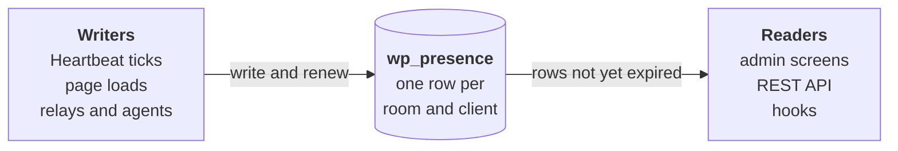

# Presence API docs

Presence API shows who else is working on a WordPress site: who is logged in, which screen they are on, and which posts they have open. New to it? Start with the [Introduction](introduction.md).

Under the hood, everything it knows is a row in one table, `wp_presence`, and a row counts until it expires.

## How it works

| Page | Covers |
| --- | --- |
| [Rows and rooms](rows-and-rooms.md) | What a row holds, how it expires, and how rooms group rows |
| [Writers](writers.md) | Everything that writes rows, and which rows each keeps alive |
| [Readers](readers.md) | How reads skip expired rows, and how a reader learns a room changed |
| [Heartbeat and tabs](heartbeat-and-tabs.md) | How the browser sends presence and receives updated markup |

## Systems

| Page | Covers |
| --- | --- |
| [Admin screens](admin-screens.md) | The admin bar, Active Posts, the Editors column and the Users list |
| [Post locks](post-locks.md) | `_edit_lock` kept in the presence table instead of post meta |
| [Real-time collaboration](real-time-collaboration.md) | Block editor awareness stored as presence rows |
| [Push transports](push-transports.md) | Rows written and refreshed without waiting for Heartbeat |
| [AI agents](ai-agents.md) | Rows written when an agent saves a post |
| [Stale-screen notices](stale-screen-notices.md) | A notice when someone else saves the screen you have open |
| [Synced patterns](synced-patterns.md) | A notice on a synced pattern while someone edits the pattern itself |
| [Multisite](multisite.md) | Who is online on each site, collected for Network Admin |

## Reference

[Reference](reference.md) lists every public function and hook with the version it arrived in, generated from the code. These pages describe the plugin's `main` branch, and [Presence Scenes in Playground](https://playground.wordpress.net/?blueprint-url=https://raw.githubusercontent.com/WordPress/presence-api/main/blueprint-scenes.json) shows them running without an install.
