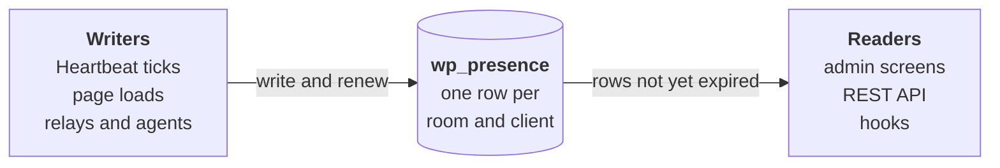

# Presence API docs

Presence API shows who else is working on a WordPress site: who is logged in, which screen they are on, and which posts they have open. Under the hood, everything it knows is a row in one table, `wp_presence`, and a row counts until it expires.

## Where to start

- To use it on a site, read the [Introduction](introduction.md), [Admin screens](admin-screens.md), [Stale-screen notices](stale-screen-notices.md) and [Post locks](post-locks.md).
- To build with it, read every page in order from the [Introduction](introduction.md), then try the [Project](project.md).

These pages describe the plugin's `main` branch.
