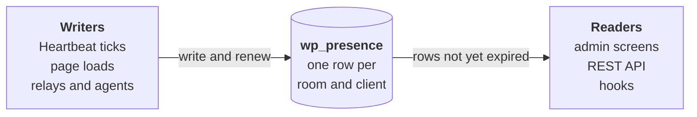

# Presence API docs

Presence API shows who else is working on a WordPress site: who is logged in, which screen they are on, and which posts they have open. Under the hood, everything it knows is a row in one table, `wp_presence`, and a row counts until it expires.

## Learning pathways

| Pathway | For | Read |
| --- | --- | --- |
| Use it | Site owners and editors | [Introduction](introduction.md), [Admin screens](admin-screens.md), [Stale-screen notices](stale-screen-notices.md) and [Post locks](post-locks.md) |
| Build with it | Developers who know WordPress hooks and the REST API | Every chapter in order, then the [Project](project.md) |

Each page ends with one question to check your understanding.

## 1. Start here

Understand what presence shows in WordPress, and how it knows.

| Page | Covers |
| --- | --- |
| [Introduction](introduction.md) | What you see in WordPress, how it knows, and the words these docs use |

## 2. How it works

Understand how rows are written, renewed, grouped and read.

| Page | Covers |
| --- | --- |
| [Rows and rooms](rows-and-rooms.md) | What a row holds, how it expires, and how rooms group rows |
| [Writers](writers.md) | Everything that writes rows, and which rows each keeps alive |
| [Readers](readers.md) | How reads skip expired rows, and how a reader learns a room changed |
| [Heartbeat and tabs](heartbeat-and-tabs.md) | How the browser sends presence and receives updated markup |

## 3. Systems

Understand how each feature is built from those rows.

| Page | Covers |
| --- | --- |
| [Admin screens](admin-screens.md) | The admin bar, Active Posts, the Editors column and the Users list |
| [Post locks](post-locks.md) | `_edit_lock` kept in the presence table instead of post meta |
| [Real-time collaboration](real-time-collaboration.md) | Block editor awareness stored as presence rows |
| [Push transports](push-transports.md) | Rows written and refreshed without waiting for Heartbeat |
| [AI agents](ai-agents.md) | Rows written when an agent saves a post |
| [Stale-screen notices](stale-screen-notices.md) | A notice when someone else saves the screen you have open |
| [Synced patterns](synced-patterns.md) | A notice on a synced pattern while someone edits the pattern itself |
| [Multisite](multisite.md) | Who is online on each site, collected for Network Admin |

## 4. Project

Apply what you learned by building on presence, or by contributing to it.

| Page | Covers |
| --- | --- |
| [Project](project.md) | Three briefs, a custom room, a push transport and a contribution, each with a list to check against |

## 5. Reference

| Page | Covers |
| --- | --- |
| [Reference](reference.md) | Every public function and hook, with the version it arrived in, generated from the code |

These pages describe the plugin's `main` branch.
