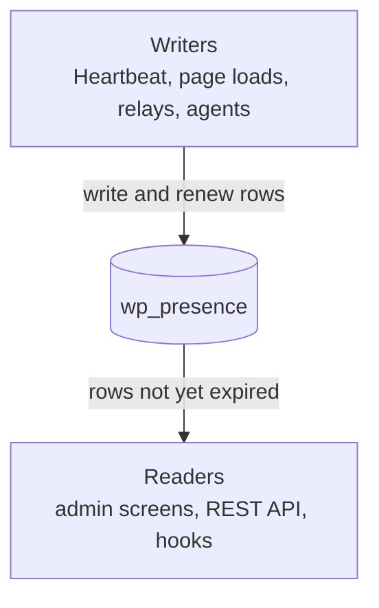

# Presence API docs

Presence API records who is where in WordPress. Every part of it writes or reads rows in one table, `wp_presence`, and a row counts as present until it expires.

## How it works

1. [Rows and rooms](rows-and-rooms.md): what a row holds, how it expires, and how rooms group rows.
2. [Writers](writers.md): everything that writes rows, and which rows each keeps alive.
3. [Readers](readers.md): how reads skip expired rows, and how a reader learns a room changed.
4. [Heartbeat and tabs](heartbeat-and-tabs.md): how the browser sends the ping and receives updated markup.

## Systems

- [Admin screens](admin-screens.md): the admin bar, Active Posts, the Editors column and the Users list.
- [Post locks](post-locks.md): `_edit_lock` kept in the presence table instead of post meta.
- [Real-time collaboration](real-time-collaboration.md): block editor awareness stored as presence rows.
- [Push transports](push-transports.md): rows written and refreshed without waiting for Heartbeat.
- [AI agents](ai-agents.md): rows written when an agent saves a post.
- [Stale-screen notices](stale-screen-notices.md): a notice when someone else saves the screen you have open.
- [Synced patterns](synced-patterns.md): a notice on a synced pattern while someone edits the pattern itself.
- [Multisite](multisite.md): who is online on each site, collected for Network Admin.

[Presence Scenes in Playground](https://playground.wordpress.net/?blueprint-url=https://raw.githubusercontent.com/WordPress/presence-api/main/blueprint-scenes.json) shows all of this running without an install. The [README](https://github.com/WordPress/presence-api#readme) lists every function, hook, REST route and WP-CLI command.
