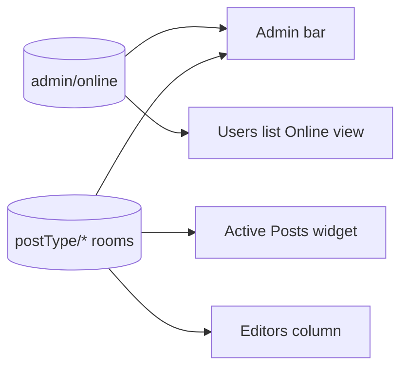

# Admin screens

These are the places in the WordPress admin where you see who else is around.

## How it works

| Screen | Shows |
| --- | --- |
| Admin bar | Who is online, who is on this page, and what each person is editing |
| Active Posts | Each post being edited, its editors, and who holds its lock |
| Editors column | Who is editing each post in a post list |
| Users list | An Online view and count |

Each refreshes from markup in the Heartbeat answer, as [live surfaces](heartbeat-and-tabs.md#live-surfaces).

Who sees each screen follows [Access](rows-and-rooms.md#access): a post's title only shows to someone who can edit the post, and another person's screen only to someone with `list_users`. A person whose row has not been written for 75 seconds is shown as idle.

Each has a switch on Settings > Presence API, which removes the screen and leaves the rows unchanged.

Source: [`admin-bar.php`](https://github.com/WordPress/presence-api/blob/main/plugins/presence-api/includes/admin-bar.php) · [`class-wp-presence-widget-active-posts.php`](https://github.com/WordPress/presence-api/blob/main/plugins/presence-api/includes/widgets/class-wp-presence-widget-active-posts.php) · [`post-list.php`](https://github.com/WordPress/presence-api/blob/main/plugins/presence-api/includes/post-list.php) · [`user-list.php`](https://github.com/WordPress/presence-api/blob/main/plugins/presence-api/includes/user-list.php)

## Check your understanding

You switch off the admin bar on Settings > Presence API. Are you still recorded as online?

Yes. The switch removes the screen, and Heartbeat still writes your row.

