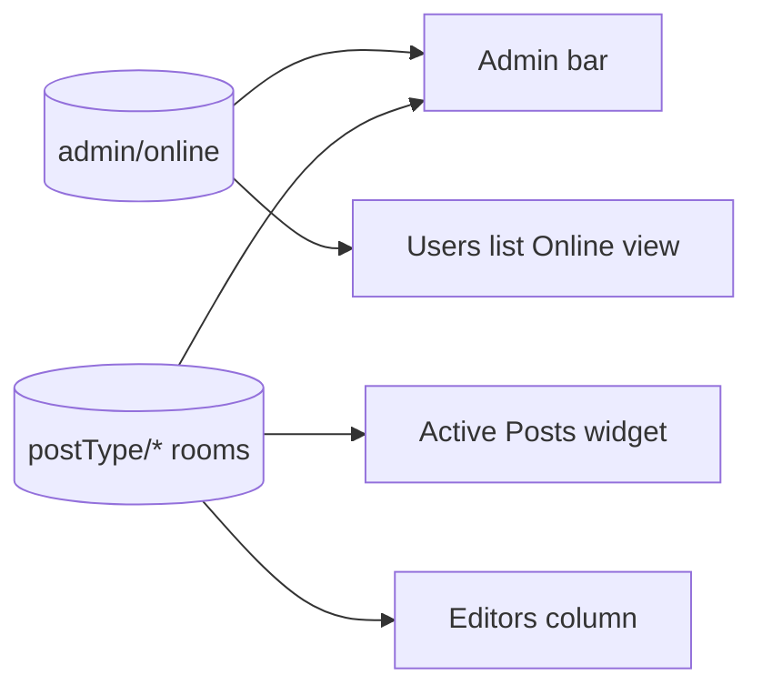

# Admin screens

Four admin screens show presence. Each reads `admin/online` or the post rooms, and refreshes from markup in the Heartbeat answer.

| Screen | Shows | Refreshes from | Switch |
| --- | --- | --- | --- |
| Admin bar | Who is online, who is on this page, and what each person is editing | `admin-bar` surface | Admin bar |
| Active Posts | Each post being edited, its editors, and who holds its lock | `active-posts` surface | Dashboard widget |
| Editors column | Who is editing each post in a post list | `editors` surface, answered with core's lock check | Posts list |
| Users list | An Online view and count | `users-list` and `users-online-count` surfaces | Users list |

Every screen requires the capability to edit at least one post type shown in the admin. A post's title appears only to someone who can edit that post, and another person's screen only to someone with `list_users`. Someone idle for 75 seconds is marked idle.

The switches are on Settings > Presence API. Turning one off removes the screen and leaves the rows unchanged.

Source: [`includes/admin-bar.php`](https://github.com/WordPress/presence-api/blob/main/plugins/presence-api/includes/admin-bar.php), [`includes/widgets/class-wp-presence-widget-active-posts.php`](https://github.com/WordPress/presence-api/blob/main/plugins/presence-api/includes/widgets/class-wp-presence-widget-active-posts.php), [`includes/post-list.php`](https://github.com/WordPress/presence-api/blob/main/plugins/presence-api/includes/post-list.php), [`includes/user-list.php`](https://github.com/WordPress/presence-api/blob/main/plugins/presence-api/includes/user-list.php)
