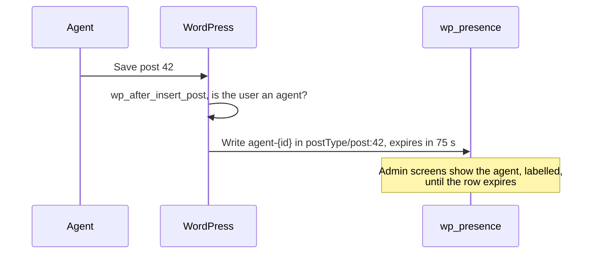

# AI agents

An AI agent that edits posts through the API has no browser tab, so it never checks in. Instead, each time it saves a post, Presence API shows it working on that post for the next 75 seconds.

## How it works

- `wp_presence_is_agent_user( $user_id )` decides who is an agent. It is a filter, `false` by default, and the plugin answers it with `wpai_is_agent_user()` when that function exists.
- A save by a person writes nothing. Neither does saving an auto-draft or trashing a post.
- The admin bar, Active Posts and the Editors column label the agent. The editor count behind `wp_presence_collaboration_started` leaves it out.
- To appear before its first save, or to stay present between saves, an agent writes its own row with a short `expires_in` and renews it. See [Agents](https://github.com/WordPress/presence-api#agents) in the README.

Source: [`presence.php`](https://github.com/WordPress/presence-api/blob/main/plugins/presence-api/includes/presence.php)

## Check your understanding

An agent saves a post once and stops. How long does it appear on that post?

75 seconds, until its `agent-` row expires.

