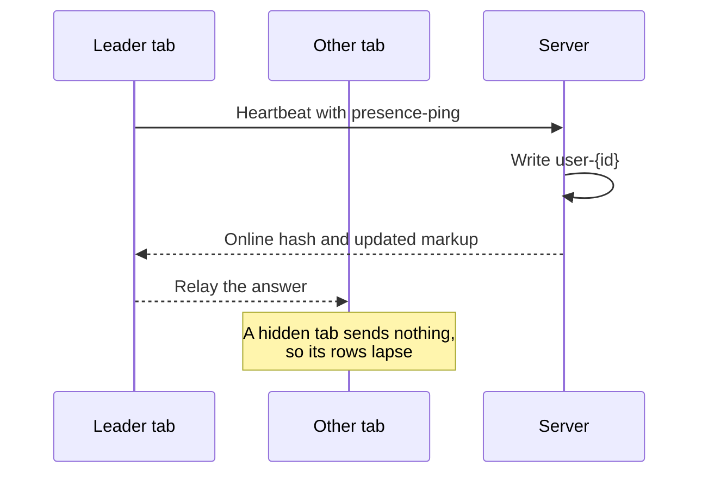

# Heartbeat and tabs

Open tabs check in with the site through Heartbeat, WordPress's built-in check-in. When you have several tabs on the same screen, one checks in for all of them and shares the answer.

## How it works

## The leader

Tabs showing the same screen elect one leader with `navigator.locks` and share its answers over `BroadcastChannel`. When the leader is hidden or closed, another visible tab takes over.

## The interval

The plugin uses core's Heartbeat interval. After five ticks with an unchanged online hash it widens the interval, staying under the TTL, and a new hash, a key press or the tab becoming visible narrows it again.

## Live surfaces

Each Heartbeat answer can carry fresh markup for a part of the screen, under `presence-fragments`:

| Surface | Screen |
| --- | --- |
| `admin-bar` | Every screen with the admin bar |
| `active-posts` | Dashboard |
| `editors` | Post lists |
| `users-list`, `users-online-count` | Users |
| `network-widget` | Network Admin dashboard |

A surface is replaced only when its markup changed, and not while the pointer or focus is inside it. The admin bar menu updates while open and waits only for focus.

## JavaScript hooks

| Hook | Use |
| --- | --- |
| `presence-api.roomChanged` | Action: ask for a fresh answer now |
| `presence-api.keepalive` | Filter: stop Heartbeat writing this tab's rows |
| `presence-api.liveSurfaces` | Filter: add a surface |
| `presence-api.surfaceUpdated` | Action: runs after a surface is replaced |

Source: [`presence-ping.js`](https://github.com/WordPress/presence-api/blob/main/plugins/presence-api/assets/js/presence-ping.js) · [`tab-coordinator.js`](https://github.com/WordPress/presence-api/blob/main/plugins/presence-api/assets/js/tab-coordinator.js)

## Check your understanding

You have three tabs open on the dashboard. How many send <code>presence-ping</code>?

One, the leader. The other two receive its answer over `BroadcastChannel`.

