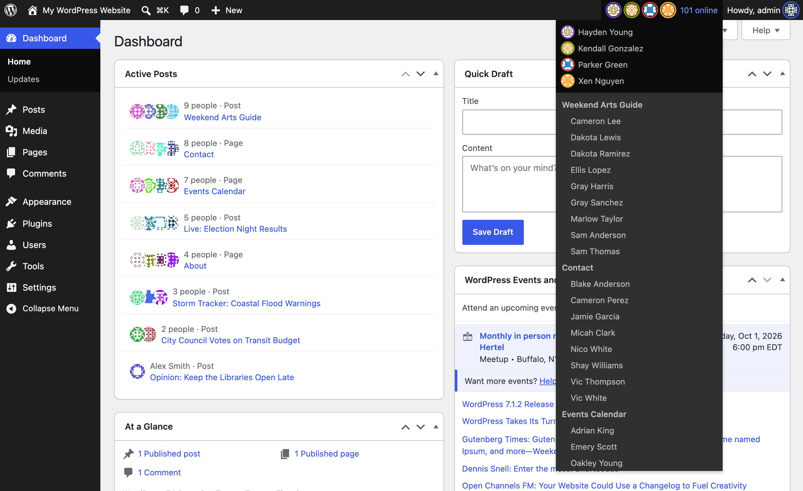
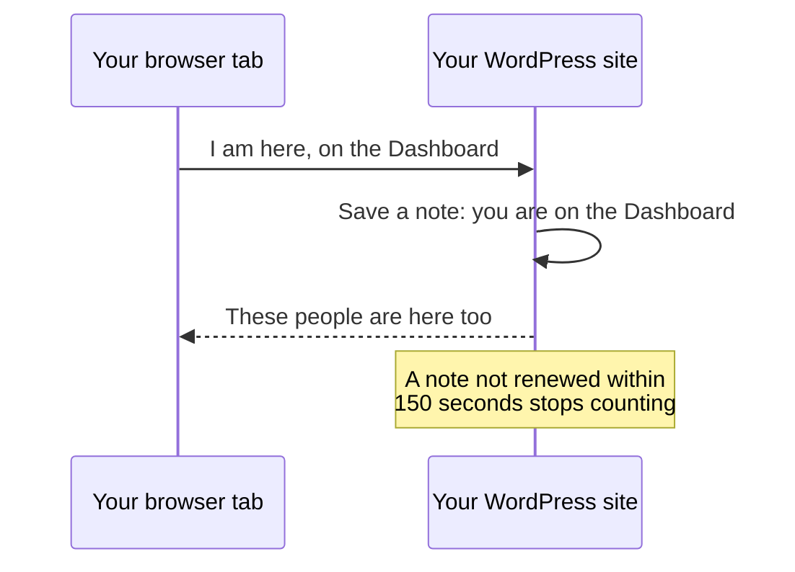

# Introduction

When several people work on one WordPress site, Presence API shows who else is there: who is logged in, which screen they are on, and which posts they have open.

## What you see

- Faces in the admin bar for everyone online, and a menu saying where each person is.
- An Active Posts box on the dashboard, listing each post someone has open.
- An Editors column on the Posts screen, showing who has each post open.
- An Online view on the Users screen.
- A notice when someone else saves a screen you have open, so you do not overwrite their change.

## How it knows

WordPress already has a built-in check-in called Heartbeat: about once a minute, each open tab sends a small request to the site. Presence API adds which screen you are on. The site saves that as a short note, and replies with who else is around.

A note counts for 150 seconds. Each check-in renews it, so when you close the tab or your connection drops, you disappear from everyone else's screen shortly after, without logging out.

## Words used in these docs

| Word | Meaning |
| --- | --- |
| Row | One saved note: this person is in this place, until this time |
| Room | A place people can be, such as the whole admin or one post |
| Heartbeat | WordPress's built-in check-in from each open tab |
| TTL | How long a row counts without being renewed, 150 seconds by default |
| Writer | Anything that saves rows, such as Heartbeat |
| Reader | Anything that shows rows, such as the admin bar |

## Where to go next

[Rows and rooms](rows-and-rooms.md) starts the technical explanation, and each page under Systems explains one feature from what you see down to the code.
