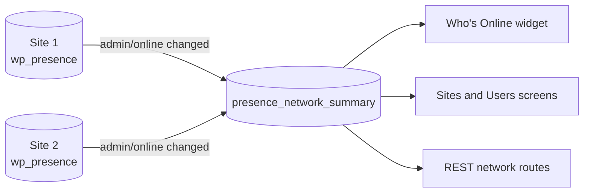

# Multisite

On a network of sites, Network Admin shows how many people are online on each site.

## How it works

- A write to a site's `admin/online` room fires `wp_presence_admin_room_changed`, which pushes that site's online users to `{base_prefix}presence_network_summary`.
- A push is skipped while the site's online users are unchanged and the last push is recent, about 105 seconds.
- Reads count a site only if its summary was updated within the TTL.
- Collection is on unless `wp_is_large_network()` is true, and `wp_presence_network_aggregation_enabled` overrides that.
- Network screens and routes require `manage_network` by default.

| Route | Returns |
| --- | --- |
| `GET /wp-presence/v1/presence/network` | Sites with users online, busiest first |
| `GET /wp-presence/v1/presence/network/{blog_id}` | One site's users online |

The switch is Network Admin screens, on the network's settings page.

Source: [`includes/network-functions.php`](https://github.com/WordPress/presence-api/blob/main/plugins/presence-api/includes/network-functions.php), [`includes/schema.php`](https://github.com/WordPress/presence-api/blob/main/plugins/presence-api/includes/schema.php)

## Check your understanding

A site's online users have not changed, and its last push was 30 seconds ago. Does it push again?

No. A push is skipped while the users are unchanged and the last push is under about 105 seconds old.

