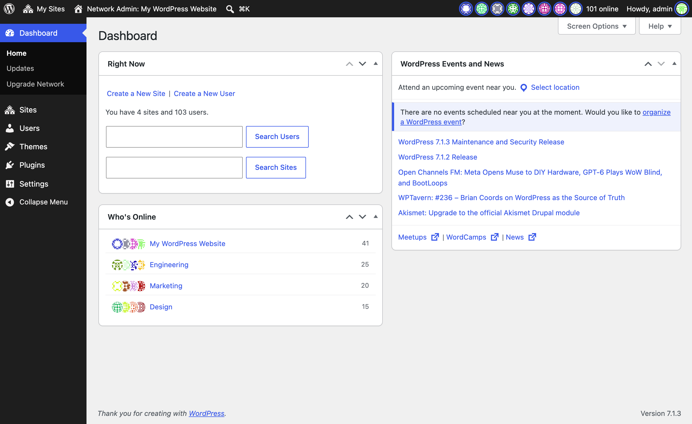
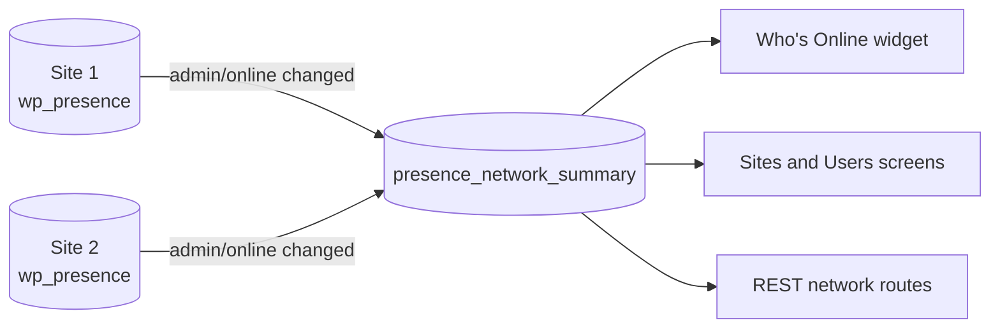

# Multisite

On a network of sites, Network Admin shows how many people are online on each site.

## How it works

- When a site's `admin/online` room changes, the site pushes its online users to `{base_prefix}presence_network_summary`.
- While nothing changes, a site still pushes often enough that its summary never goes stale.
- Large networks, as `wp_is_large_network()` decides, skip collection unless the `wp_presence_network_aggregation_enabled` filter turns it on.
- Network screens and routes require `manage_network` by default.

| GET route | Returns |
| --- | --- |
| `/wp-presence/v1/presence/network` | Sites with users online, busiest first |
| `/wp-presence/v1/presence/network/{blog_id}` | One site's users online |

Turn it off with Network Admin screens on the network's settings page.

Source: [`network-functions.php`](https://github.com/WordPress/presence-api/blob/main/plugins/presence-api/includes/network-functions.php) · [`schema.php`](https://github.com/WordPress/presence-api/blob/main/plugins/presence-api/includes/schema.php)

## Check your understanding

Nobody has arrived or left a site for an hour. Does Network Admin still show who is there?

Yes. The site keeps pushing while nothing changes, often enough that its summary never goes stale.

