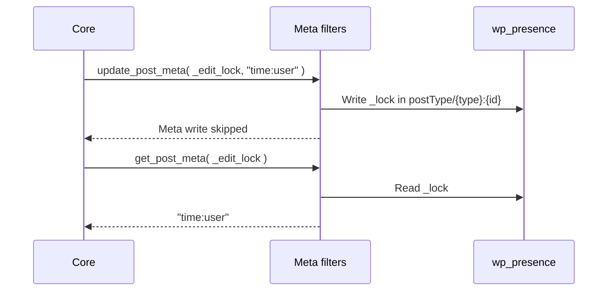

# Post locks

When you open a post someone else is editing, WordPress warns you that it is locked. Presence API keeps that lock in its own table instead of with the post, so renewing it while you edit does not slow down the rest of the site.

## How it works

Core's post lock, `_edit_lock`, is stored as the post room's `_lock` row instead of post meta. Core keeps calling the meta API, and filters answer from the row.

- `update_post_metadata`, `get_post_metadata` and `delete_post_metadata` filters write, read and remove the row, so `wp_check_post_lock()` and other callers work unchanged.
- It applies to every post type, including ones without presence support.
- The row expires after `wp_check_post_lock_window`, 150 seconds by default, as the meta lock would.
- `_lock` is reserved, so it is written even with recording off, kept at logout, and left out of reads.
- With the Post locks switch off, locks stay in post meta, as in core.

Moving locks out of post meta stops each lock refresh from bumping the posts `last_changed` value. On a synthetic large site with a Redis object cache, [#836](https://github.com/WordPress/presence-api/issues/836) measured the post query cache miss rate at about 10% with locks in post meta and about 5% with locks in `wp_presence`.

Source: [`includes/post-lock-bridge.php`](https://github.com/WordPress/presence-api/blob/main/plugins/presence-api/includes/post-lock-bridge.php)
