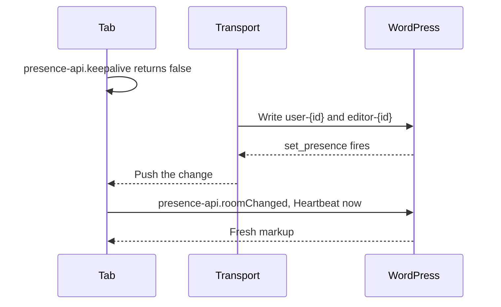

# Push transports

Normally a change, such as someone arriving, shows up at the next check-in, up to a minute later. A push transport, such as a WebSocket service, sends the change to open tabs right away.

## How it works

## Holding a tab's rows

1. Return `false` from the `presence-api.keepalive` JS filter while connected. Heartbeat keeps running for markup and post locks but stops writing `user-{id}` and `editor-{id}`.
2. Write those rows with `wp_set_presence()`, building their state with `wp_presence_admin_state()` and `wp_presence_editor_state()` so they match what Heartbeat would write.
3. When the user's last connection closes, remove the rows or let a short `expires_in` lapse. The tab no longer removes them on `pagehide`.

## Telling tabs to refresh

Listen to `set_presence`, `removed_presence` and `wp_presence_room_changed`, push the room to open tabs, and fire `presence-api.roomChanged` there. A visible leader tab then sends a Heartbeat at once, and the other tabs receive its answer.

Source: [`presence-ping.js`](https://github.com/WordPress/presence-api/blob/main/plugins/presence-api/assets/js/presence-ping.js) · [`presence-api.keepalive`](https://github.com/WordPress/presence-api#presence-apikeepalive)

## Check your understanding

A tab returns <code>false</code> from <code>presence-api.keepalive</code> and then closes. What removes its rows?

Not the tab, which skips its removal on `pagehide` while a transport holds the rows. The transport removes them, or lets a short `expires_in` lapse.

