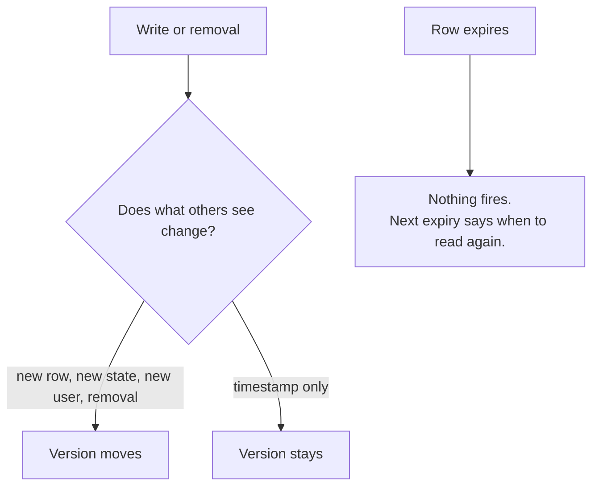

# Readers

The admin bar and the other screens show only rows that have not run out. A room's version number tells code when something visible changed, so it knows when to look again.

## How it works

## Reading

`wp_get_presence( $room )` returns the room's unexpired rows, leaving out reserved ones. Within one request, a room is read once and served from memory until the table changes.

## Knowing when to read again

`wp_get_presence_room_versions()` returns each room's version, and `wp_get_presence_room_next_expiry()` the time its next row expires. Code can also listen for these actions:

| Action | Fires when |
| --- | --- |
| `set_presence` | Any write that touches a row, including one that only renews it |
| `removed_presence` | A row is removed, never when one expires |
| `removed_user_presence` | All of a user's rows are removed at once |
| `wp_presence_room_changed` | A post someone is editing changes its title or status, for the post room and `admin/online` |
| `wp_presence_admin_room_changed` | A write to `admin/online` touches a row |

Reserved rows move no version and fire none of these actions. On multisite, `wp_presence_admin_room_changed` refreshes the [network summary](multisite.md), and a [push transport](push-transports.md) listens to the rest.

Source: [`includes/presence.php`](https://github.com/WordPress/presence-api/blob/main/plugins/presence-api/includes/presence.php)

## Check your understanding

A write only renews a row's timestamp. Does the room's version move, and does <code>set_presence</code> fire?

The version stays, because nothing others see changed. `set_presence` still fires, because the write touched the row.

