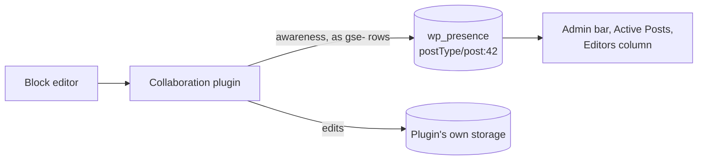

# Real-time collaboration

When several people edit one post at the same time, the editor shows each person's cursor. If the plugin behind that keeps those cursors in Presence API's table, the same people also appear in the admin bar and the post lists.

## How it works

A plugin that implements the block editor's collaboration storage can keep its awareness rows in `wp_presence`. Its collaborators then appear on admin screens, while its edit history stays in its own storage.

- Both sides name a post's room `postType/{type}:{id}`, the grammar of Gutenberg's sync rooms and of `wp_presence_post_room()`.
- The plugin writes under its own prefix, such as `gse-` for [gutenberg-sync-engines](https://github.com/WordPress/gutenberg-sync-engines), and reads its rows back with `client_prefix`.
- `wp_set_presence()` accepts `date_gmt` and `expires_in`, so a relay can keep each client's own timestamp and lifetime.

## Collaboration signals

This plugin counts a post room's editors by its own `editor-` rows. Rows under any other prefix, and agent rows, are not counted.

| Signal | Fires when |
| --- | --- |
| `wp_presence_collaboration_started` | A post room goes from one editor to two or more |
| `wp_presence_collaboration_ended` | It goes back to one |
| `presence-api.collaborationStarted`, `presence-api.collaborationEnded` | The same edges, in the editor's browser |
| `presence-api.watchingRoom` | The editor's script loads in a post room |

The last count is kept in the reserved `_collab` row, so the edges hold across requests. A collaboration plugin can wait for `presence-api.collaborationStarted` instead of polling to learn whether anyone else is editing.

## Reading a room in the editor

`wp.presence.usePresenceUsers( room )`, in the `wp-presence` script, returns the other people in a room. It reads the room over the REST API on each Heartbeat tick, from one tab.

Source: [`includes/heartbeat.php`](https://github.com/WordPress/presence-api/blob/main/plugins/presence-api/includes/heartbeat.php), [`src/hooks/use-presence-users.js`](https://github.com/WordPress/presence-api/blob/main/plugins/presence-api/src/hooks/use-presence-users.js), [Relationship to the block editor](https://github.com/WordPress/presence-api#relationship-to-the-block-editor)

## Check your understanding

A collaboration plugin writes <code>gse-</code> rows in a post room. Do they count toward <code>wp_presence_collaboration_started</code>?

No. The count uses this plugin's `editor-` rows only.

