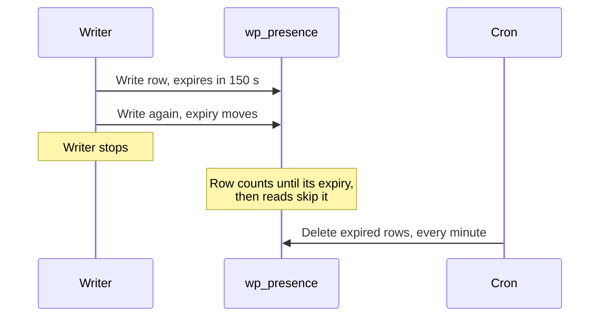

# Rows and rooms

A row is one client in one room. Writing it again renews it, and once its expiry passes, reads leave it out.

## Why a table of its own

Core bumps the posts `last_changed` value on every post meta write, and `WP_Query` salts its cache with that value, so storing presence in post meta would invalidate every cached post query on each Heartbeat tick. `wp_presence` is touched by presence alone, and needs no object cache or service beyond WordPress.

## The row

| Column | Holds |
| --- | --- |
| `room` | Where the client is |
| `client_id` | Whose row it is within the room |
| `user_id` | The user, or `0` |
| `session_hash` | Which browser login wrote it, keyed per room |
| `data` | JSON state, such as the screen |
| `date_gmt` | When it was last written |
| `expires_gmt` | When it stops counting |

A unique key on `room` and `client_id` makes `wp_set_presence()` an upsert.

## Expiry

| Value | Default |
| --- | --- |
| TTL | 150 seconds, `WP_PRESENCE_DEFAULT_TTL`, filtered by `wp_presence_default_ttl` |
| `expires_in` passed to `wp_set_presence()` | Up to one hour, capped by `wp_presence_max_expires_in` |
| Cleanup cron, `wp_delete_expired_presence_data` | Every minute |

The TTL outlasts the 120 seconds core's Heartbeat waits in a tab without focus, so a ticking tab's row never lapses between ticks. Reads filter on `expires_gmt`, so the cron only removes rows reads already skip.

## Rooms

| Room | Holds |
| --- | --- |
| `admin/online` | One row per person on an admin screen |
| `postType/{type}:{id}` | One row per person editing that post, in the grammar Gutenberg's sync rooms use |
| Any other string | A plugin's own room, such as `my-plugin/order:123` |

## Client IDs

| Client ID | Written by |
| --- | --- |
| `user-{user_id}` | This plugin, one per person in `admin/online` |
| `editor-{user_id}` | This plugin, one per person in a post room |
| `agent-{user_id}` | An AI agent's save |
| `cli-{user_id}` | `wp presence set` without a client ID |
| `_lock`, `_collab`, `_version` | This plugin, as bookkeeping |
| Any other prefix, such as `gse-` | Another plugin, reading its rows back with `client_prefix` |

A client ID starting with `_` is reserved: reads leave it out, and the REST routes refuse to write or delete it.

## Access

`wp_can_access_presence_room()` requires `edit_post` for a post room, and for any other room the capability to edit at least one post type shown in the admin. Seeing which screen someone is on also requires `list_users`, through the `view_presence_location` meta capability.

Source: [`includes/schema.php`](https://github.com/WordPress/presence-api/blob/main/plugins/presence-api/includes/schema.php), [`includes/presence.php`](https://github.com/WordPress/presence-api/blob/main/plugins/presence-api/includes/presence.php)
