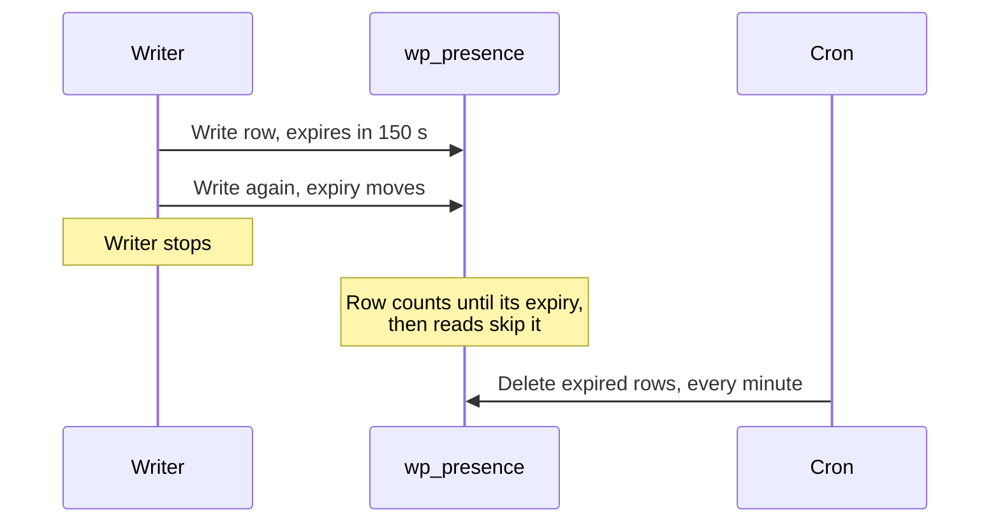

# Rows and rooms

Everything Presence API knows is kept as rows: short notes that say one client is in one room, until a given time. A row stays as long as its writer keeps renewing it, and stops counting once its time runs out.

## How it works

## Why a table of its own

Core bumps the posts `last_changed` value on every post meta write, and `WP_Query` salts its cache with that value, so storing presence in post meta would invalidate every cached post query on each Heartbeat tick. `wp_presence` is touched by presence alone, and needs no object cache or service beyond WordPress.

## The row

| Column | Holds |
| --- | --- |
| `room` | Where the client is |
| `client_id` | Whose row it is within the room |
| `user_id` | The user, or `0` |
| `session_hash` | Which browser login wrote it, keyed per room |
| `data` | JSON state, such as the screen |
| `date_gmt` | When it was last written |
| `expires_gmt` | When it stops counting |

A unique key on `room` and `client_id` makes `wp_set_presence()` an upsert.

## Expiry

- A row counts for 150 seconds by default, longer than the 120 seconds Heartbeat waits in a background tab, so a ticking tab's row never lapses. The `wp_presence_default_ttl` filter changes it.
- A writer can pass `expires_in` to `wp_set_presence()`, up to one hour.
- Reads skip expired rows, and a cron event deletes them every minute.

## Rooms

| Room | Holds |
| --- | --- |
| `admin/online` | One row per person on an admin screen |
| `postType/{type}:{id}` | One row per person editing that post, in the grammar Gutenberg's sync rooms use |
| Any other string | A plugin's own room, such as `my-plugin/order:123` |

## Client IDs

Within a room, each client has its own ID: `user-{user_id}` or `editor-{user_id}` for a person, `agent-{user_id}` for an AI agent, or a plugin's own prefix, such as `gse-`, read back with `client_prefix`. An ID starting with `_`, such as `_lock`, is reserved: reads leave it out, and the REST routes refuse to write or delete it.

## Access

`wp_can_access_presence_room()` requires `edit_post` for a post room, and for any other room the capability to edit at least one post type shown in the admin. Seeing which screen someone is on also requires `list_users`, through the `view_presence_location` meta capability.

Source: [`schema.php`](https://github.com/WordPress/presence-api/blob/main/plugins/presence-api/includes/schema.php) · [`presence.php`](https://github.com/WordPress/presence-api/blob/main/plugins/presence-api/includes/presence.php)

## Check your understanding

A writer stops renewing a row. When do reads stop returning it, and when is it deleted?

Reads stop returning it as soon as its `expires_gmt` passes. The cleanup cron deletes it within the next minute.

