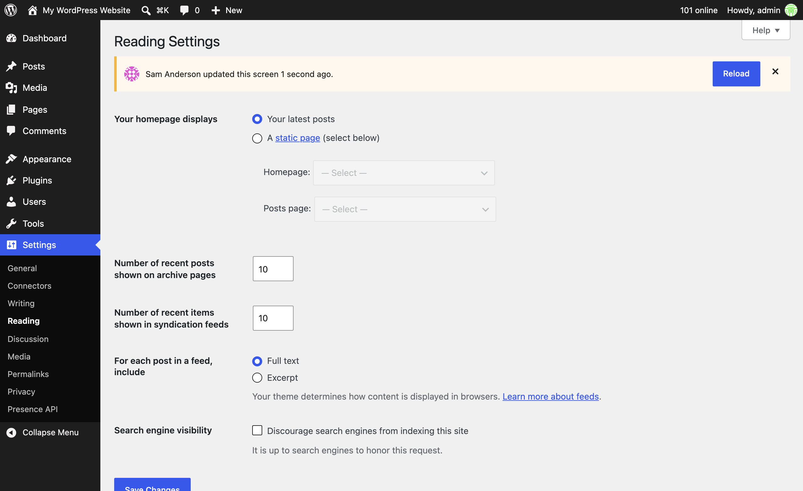
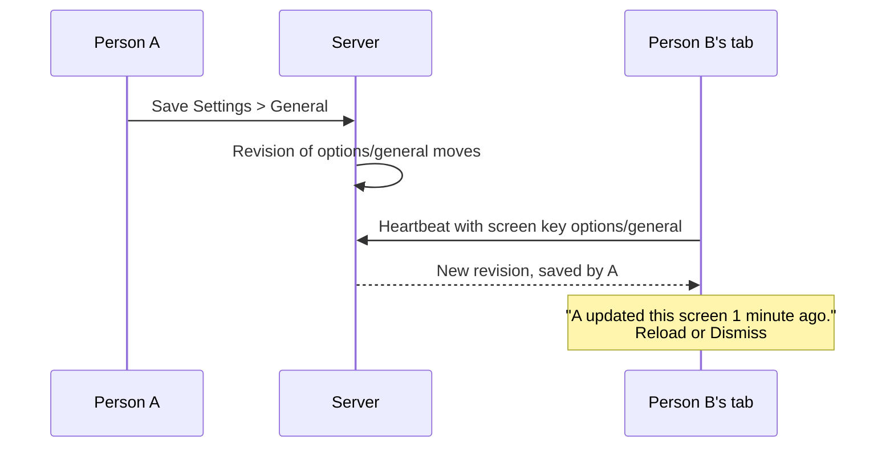

# Stale-screen notices

If someone else saves a screen you have open, such as Settings, you see a notice asking you to reload, so you do not overwrite their change.



## How it works



Each watched admin screen has a revision. When someone else saves it, every open copy shows a notice on its next Heartbeat tick.

## Screen keys

| Screen | Key |
| --- | --- |
| A Settings page | `options/general`, or the page's option group |
| A post | `post/{id}` |
| A user | `user-edit/{id}` |
| A term | `term/{taxonomy}/{id}` |
| A comment | `comment/{id}` |
| A network setting | `network/settings`, or `network/site-info/{id}` and similar |

Another screen gets a key from the `wp_presence_current_screen_key` filter.

## Revisions

Classic screens that save with a form post and redirect move their revision on save. A screen that saves in the background, over REST or Ajax, moves it with:

```js
wp.presence.markScreenStale( 'options/my-plugin-settings' );
```

Your own saves never show you a notice, and Dismiss hides it until the next revision. Each key is checked against that screen's own capability, such as `manage_options` for Settings.

Source: [`includes/screen-revisions.php`](https://github.com/WordPress/presence-api/blob/main/plugins/presence-api/includes/screen-revisions.php), [`assets/js/stale-screen.js`](https://github.com/WordPress/presence-api/blob/main/plugins/presence-api/assets/js/stale-screen.js)
