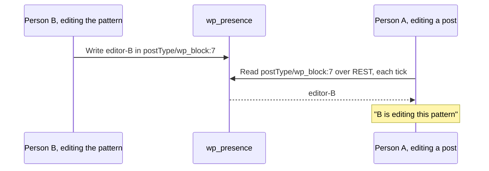

# Synced patterns

A synced pattern is a block reused in many posts. While someone edits the pattern itself, anyone using it in a post sees a notice that it is being changed.

## How it works

- A `core/block` block with a `ref` reads the room `postType/wp_block:{ref}` with `usePresenceUsers()`.
- Every copy of the same pattern in the editor shares one read.
- The person editing the pattern writes their `editor-` row from the pattern's own edit screen or the Site Editor.
- Reading the room requires `edit_post` on the pattern, and the notice cannot be dismissed while they are there.
- Turn it off with Synced patterns on Settings > Presence API.

Source: [`synced-patterns.php`](https://github.com/WordPress/presence-api/blob/main/plugins/presence-api/includes/synced-patterns.php) · [`index.js`](https://github.com/WordPress/presence-api/blob/main/plugins/presence-api/src/synced-patterns/index.js)

## Check your understanding

Who sees the notice that a synced pattern is being edited?

Only someone who can edit the pattern, since reading its room requires `edit_post` on it.

