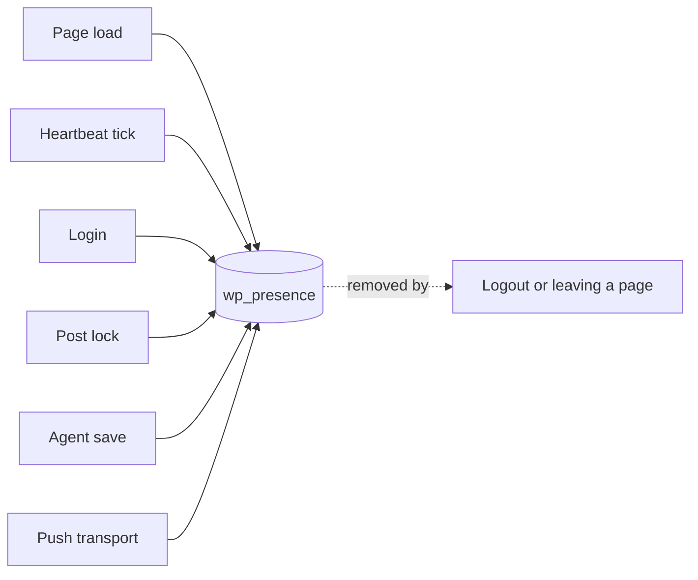

# Writers

Several things save rows: an open tab checking in, a page loading, someone logging in, an AI agent saving a post. Each keeps its own rows alive by saving them again.

## How it works

A writer keeps its rows alive by writing them again, and when it stops, they expire.

| Writer | Rows | Hook |
| --- | --- | --- |
| Page load | `user-{id}`, and `editor-{id}` on a post's edit screen | `admin_enqueue_scripts`, `wp_enqueue_scripts` |
| Heartbeat tick | The same rows, on each tick that keeps them alive | `heartbeat_received` |
| Login | `user-{id}`, with the screen `login` | `wp_login` |
| Post lock | `_lock` in the post room | `update_post_metadata` |
| Agent save | `agent-{id}` in the post room, expiring after 75 seconds | `wp_after_insert_post` |
| Push transport | `user-{id}` and `editor-{id}`, in place of Heartbeat | [Push transports](push-transports.md) |
| WP-CLI | Any row, `cli-{id}` by default | `wp presence set` |

| Remover | Rows | Hook |
| --- | --- | --- |
| Leaving a page | The tab's own rows, through `DELETE /wp-presence/v1/presence` | `pagehide` |
| Logout | Every row the user wrote, except `_lock` | `wp_logout` |
| Deleting a user | Every row the user wrote | `deleted_user` |

A write that changes nothing is skipped while the row was stamped within the last 30 seconds, so frequent ticks do not rewrite an unchanged row.

Source: [`includes/heartbeat.php`](https://github.com/WordPress/presence-api/blob/main/plugins/presence-api/includes/heartbeat.php), [`includes/lifecycle.php`](https://github.com/WordPress/presence-api/blob/main/plugins/presence-api/includes/lifecycle.php), [`assets/js/presence-ping.js`](https://github.com/WordPress/presence-api/blob/main/plugins/presence-api/assets/js/presence-ping.js)

## Check your understanding

Which rows does logging out remove, and which does it keep?

It removes every row the user wrote except `_lock`, so a post lock outlasts the logout.

